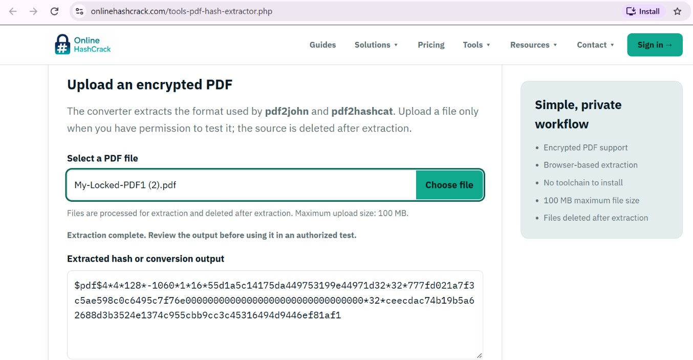
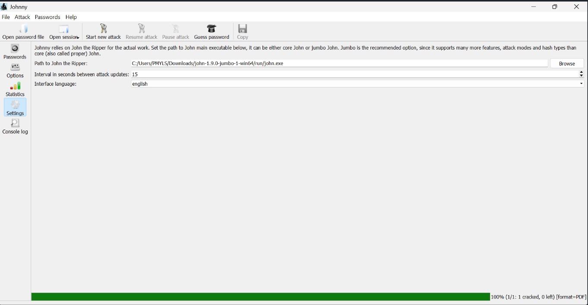
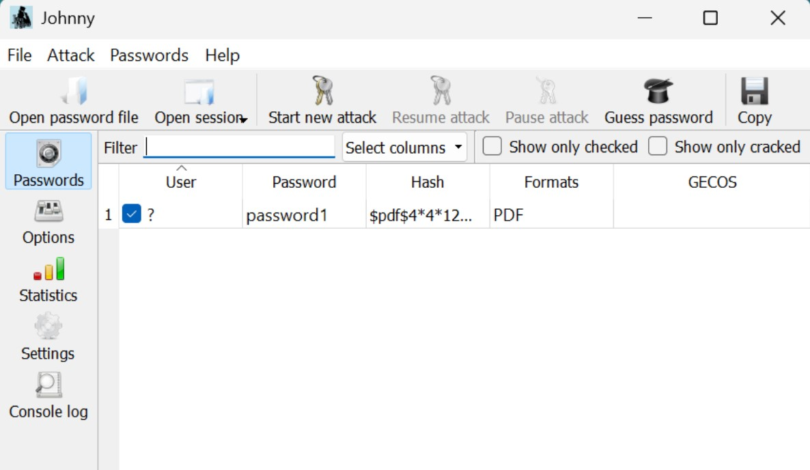
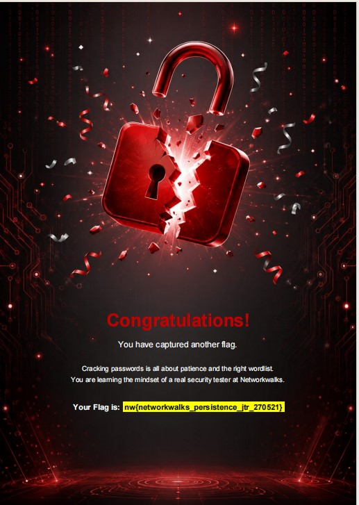
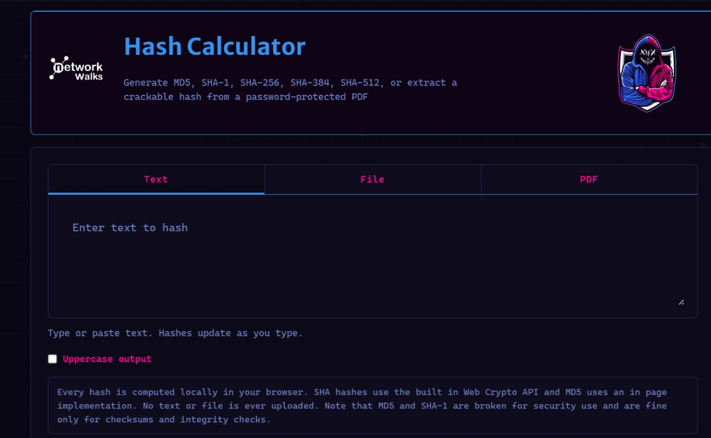
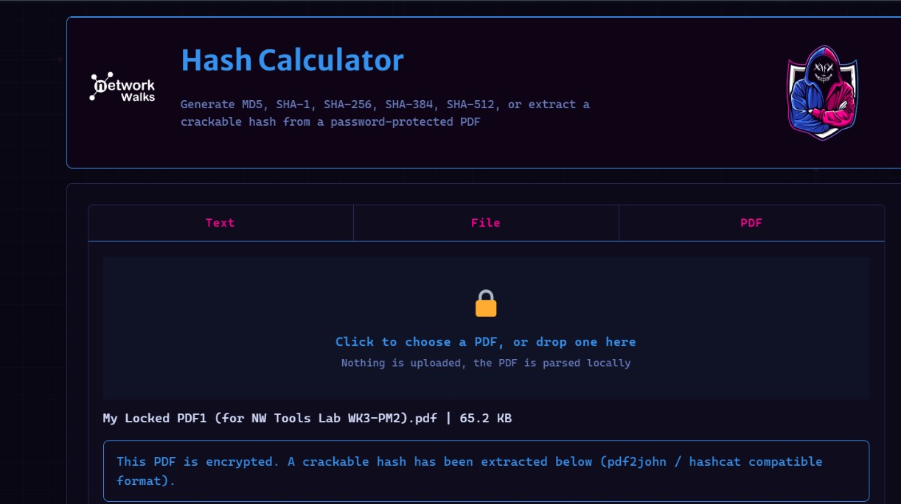
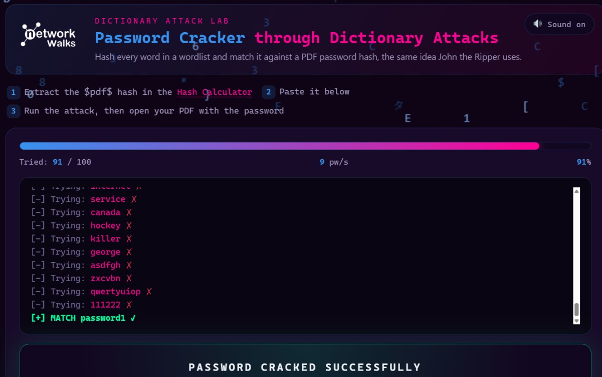
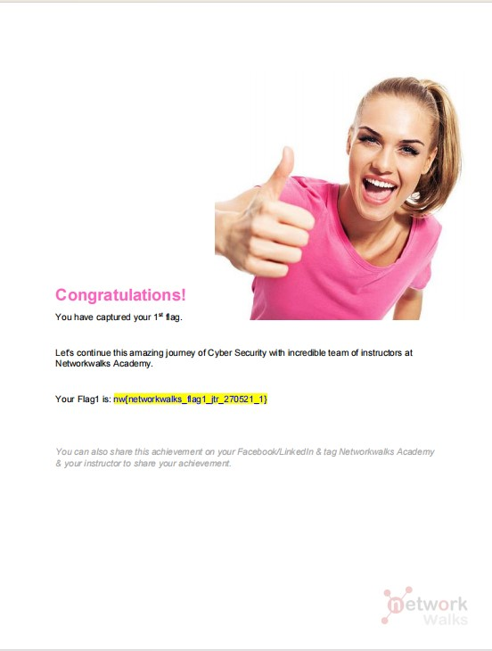

# Networkwalks-Momina-B084-week3-Cybersecurity-Password-Cracking

## PASSWORD CRACKING AND HASH ANALYSIS

---

## Overview

During Week 3 of the cybersecurity internship, I audited and recovered passwords from encrypted PDF documents (`pdf$4*4*128*` format) using both a graphical password-cracking suite (**Johnny** — John the Ripper GUI) on Windows and browser-based security utilities (**Networkwalks Tools**):

1. **W3-PM1:** Password Cracking with John the Ripper (Johnny GUI)
2. **W3-PM2:** Password Cracking with Networkwalks (NW) Tools

---

## Tools & Environment

* **Operating System:** Windows 11
* **Offline Cracking Suite:** Johnny (GUI frontend for John the Ripper)
* **Online Auditing Utility:** Networkwalks (NW) Hashes & Password Cracking Tools
* **Target Files:**
* `My Locked PDF1.pdf` (W3-PM1)
* `My Locked PDF2.pdf` (W3-PM1)
* `My Locked PDF3.pdf` (W3-PM1)
* `My Locked PDF1 (for NW Tools Lab WK3-PM2).pdf` (W3-PM2)

---

## Task Breakdown & Methodology

### 1. W3-PM1: Password Cracking with Johnny (JTR GUI)

* **Objective:** Extract cryptographic hashes from three locked PDF files, recover their plaintext passwords using Johnny GUI, and unlock each document to capture the embedded flags.
* **Workflow Executed:**
1. Extracted password hashes from the target PDF documents using online extraction tools.
2. Loaded the hash files into Johnny (John the Ripper GUI) and configured the path to John the Ripper.

3. Executed the password cracking attack, successfully recovering passwords like `password1`.

4. Unlocked the PDFs using the recovered passwords to retrieve the verification flags.

* **Proof of Execution — Hash Extraction & Johnny Configuration:**

> Configuring John the Ripper path in Johnny GUI:

> Successful password recovery (`password1`) inside Johnny GUI:

* **Proof of Execution — Unlocked PDFs & Captured Flags:**
> Flag 1 captured after unlocking `My Locked PDF1.pdf`:

> Flag 2 captured after unlocking `My Locked PDF2.pdf`:

---

### 2. W3-PM2: Password Cracking with Networkwalks (NW) Tools

* **Objective:** Recover the password of `My Locked PDF1 (for NW Tools Lab WK3-PM2).pdf` using Networkwalks' dedicated online password/hash cracking utility and cross-verify previous results.
* **Workflow Executed:**
1. Opened the Networkwalks Hash Calculator & PDF Hash Extractor portal.

2. Submitted `My Locked PDF1 (for NW Tools Lab WK3-PM2).pdf` to extract the crackable `$pdf$` hash locally in the browser.

3. Passed the extracted hash into the Password Cracker through Dictionary Attacks lab.

4. Ran the dictionary audit, which matched and recovered the password `password1`, unlocking the PDF and retrieving the flag.

* **Proof of Execution — Networkwalks Tools & Captured Flag:**
> Hash Calculator interface:

> PDF Hash Extractor:

> Dictionary attack progress matching `password1` successfully:

> Final captured flag from NW Tools Lab:

---

## Summary of Recovered Passwords & Flags

| Task ID | Target PDF File | Tool Used | Recovered Password | Captured Flag | Status |
| --- | --- | --- | --- | --- | --- |
| **W3-PM1** | `My Locked PDF1.pdf` | Johnny (JTR GUI) | `good-luck` | `nw{cybersecurity_flag_captured_2608}` | Verified |
| **W3-PM1** | `My Locked PDF2.pdf` | Johnny (JTR GUI) | `password1` | `nw{networkwalks_persistence_jtr_270521}` | Verified |
| **W3-PM1** | `My Locked PDF3.pdf` | Johnny (JTR GUI) | `1qaz2wsx` | `nw{networkwalks_flag_250821_1}` | Verified |
| **W3-PM2** | `My Locked PDF1 (for NW Tools Lab WK3-PM2).pdf` | Networkwalks Tools | `password1` | `nw{networkwalks_flag1_jtr_270521_1}` | Verified |

---

## Key Security Takeaways

* **Predictable Password Patterns:** Common dictionary words and short alphanumeric strings are vulnerable to rapid dictionary attacks once a PDF hash is exposed.
* **Defense-in-Depth:** Organizations should mandate robust passphrases for sensitive PDF documents to protect intellectual property from offline and online auditing tools.

## Author
* MOMINA KHAN
* Cyber Security and Digital Forensics Student
* LinkedIn: https://www.linkedin.com/in/momina-khan-5793453aa/
